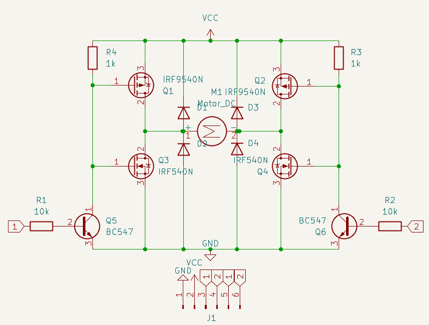

# MOSFET H-Bridge Motor Driver

A compact discrete H-bridge for driving a brushed DC motor. The design uses complementary P-channel and N-channel MOSFETs, with BC547 transistors for input-side switching.

## Design highlights

- Four power MOSFETs arranged as an H-bridge: IRF9540N high-side devices and IRF540N low-side devices
- BC547 transistor stages driven through 10 kOhm input resistors
- Diodes across the motor switching paths
- VCC, GND, two control inputs, and motor connections
- PCB outline measures approximately 57.7 x 32.5 mm

## Schematic and PCB

## Project files

- [KiCad project](driver%20mosfet.kicad_pro)
- [Schematic source](driver%20mosfet.kicad_sch)
- [PCB layout](driver%20mosfet.kicad_pcb)
